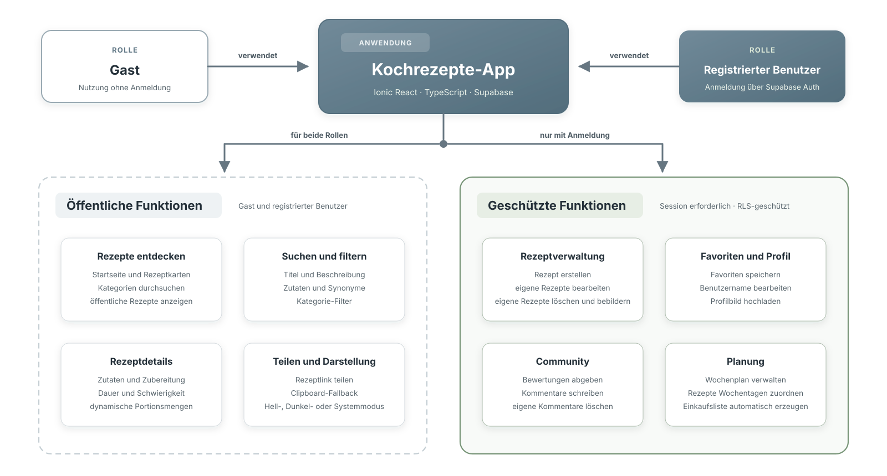
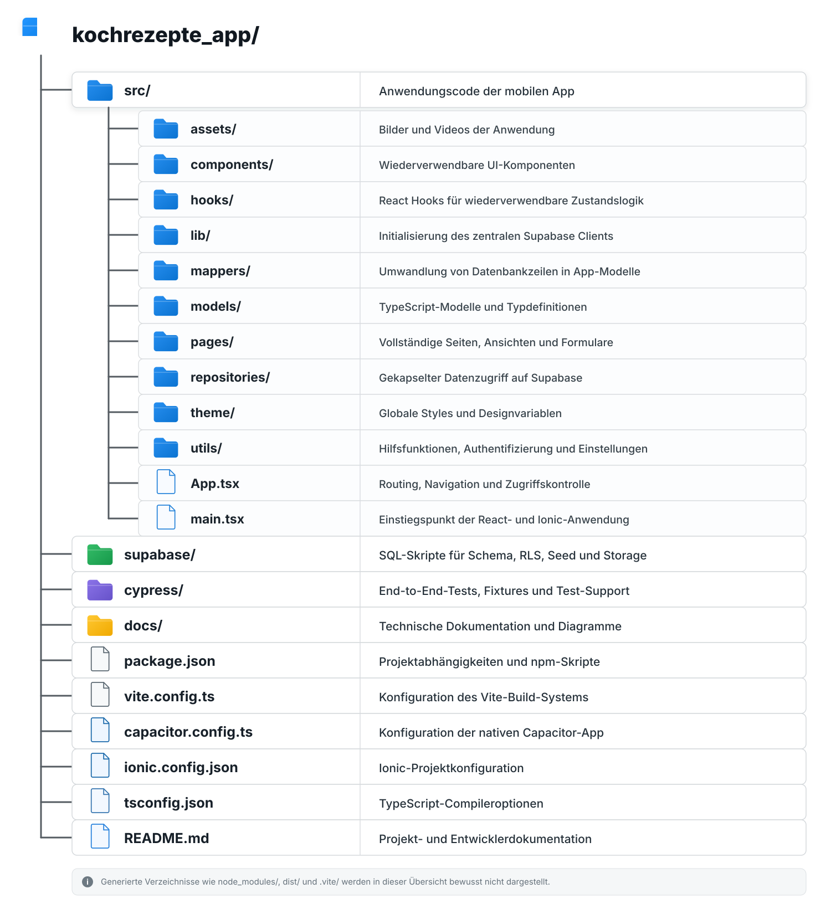
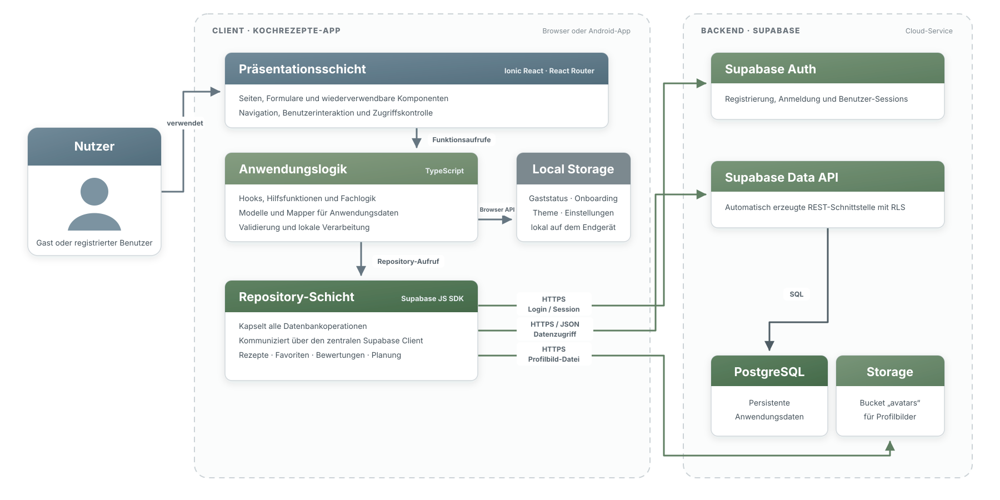
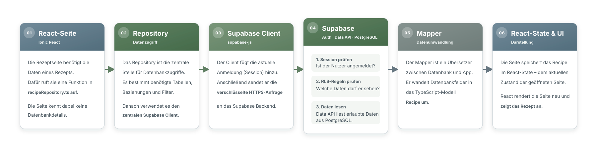

# Kochrezepte-App

Mobile Kochrezepte-App, entwickelt im Rahmen des Moduls **Entwicklung mobiler Applikationen** an der Technischen Hochschule Mittelhessen (THM).

## Inhaltsverzeichnis

- [Projektübersicht](#projektübersicht)
- [Projektziele](#projektziele)
- [Funktionen](#funktionen)
- [Technische Umsetzung](#technische-umsetzung)
- [Systemarchitektur](#systemarchitektur)
- [Anforderungen](#anforderungen)
- [Zusätzliche Hinweise](#zusätzliche-hinweise)

## Projektübersicht

Die Kochrezepte-App ist eine mobile Anwendung zur Verwaltung, Suche und Organisation von Kochrezepten. Ziel des Projekts ist die Entwicklung einer benutzerfreundlichen Plattform, auf der Anwender Rezepte entdecken, eigene Rezepte verwalten und ihre Mahlzeiten planen können.

Benutzer können Rezepte nach Namen oder vorhandenen Zutaten durchsuchen, eigene Rezepte erstellen und persönliche Favoriten verwalten. Zusätzlich unterstützt die Anwendung eine Wochenplanung sowie die automatische Erstellung einer Einkaufsliste aus den eingeplanten Rezepten.

Die Anwendung kann sowohl von Gästen als auch von registrierten Benutzern verwendet werden. Gäste können öffentliche Rezepte aufrufen und durchsuchen. Registrierte Benutzer erhalten zusätzliche Funktionen:

- eigene Rezepte erstellen, bearbeiten und löschen
- Favoriten dauerhaft speichern
- Kommentare schreiben und eigene Kommentare löschen
- Rezepte bewerten
- Rezepte einem Wochenplan zuordnen
- eine automatische Einkaufsliste erzeugen
- Benutzername und Profilbild verwalten

Die Anwendungsdaten werden zentral über Supabase gespeichert und stehen dadurch geräteübergreifend zur Verfügung.

## Projektziele

Mit der Entwicklung der Kochrezepte-App wurden folgende Ziele verfolgt:

- Entwicklung einer modernen mobilen Anwendung mit Ionic React
- Umsetzung einer intuitiven und übersichtlichen Benutzeroberfläche
- zentrale Speicherung der Anwendungsdaten in einer Cloud-Datenbank
- sichere Benutzerverwaltung durch Authentifizierung und Zugriffsregeln
- Aufbau einer wiederverwendbaren und wartbaren Softwarearchitektur
- einfache Erweiterbarkeit für zukünftige Funktionen
- klare Trennung zwischen Benutzeroberfläche und Datenzugriff
- Einsatz moderner Softwareentwicklungsstandards

## Funktionen

Die Anwendung stellt unterschiedliche Funktionen für Gäste und registrierte Benutzer bereit.

### Allgemeine Funktionen

| Funktion | Beschreibung |
|:---|:---|
| Rezeptsuche | Suche nach Rezepten über Titel, Beschreibung oder Zutaten |
| Zutatensuche | Ermittlung passender Rezepte anhand vorhandener Zutaten und bekannter Synonyme |
| Kategorien | Filterung der Rezepte nach Kategorien wie Vegan, Pasta oder Dessert |
| Rezeptdetails | Anzeige von Zutaten, Zubereitungsschritten, Dauer, Schwierigkeit und Portionsanzahl |
| Portionsanpassung | Automatische Anpassung der Zutatenmengen an die ausgewählte Personenzahl |
| Gastmodus | Nutzung der öffentlichen Bereiche ohne Benutzerkonto |
| Registrierung | Erstellung eines persönlichen Benutzerkontos |
| Anmeldung | Anmeldung mit E-Mail-Adresse und Passwort |

### Rezeptverwaltung

| Funktion | Beschreibung |
|:---|:---|
| Rezept erstellen | Eigene Rezepte mit Grunddaten, Zutaten und Zubereitungsschritten anlegen |
| Rezept bearbeiten | Selbst erstellte Rezepte aktualisieren |
| Rezept löschen | Eigene, nicht mehr benötigte Rezepte entfernen |
| Bild hinzufügen | Rezeptbild über eine Bilddatei oder eine Bild-URL hinzufügen |

### Personalisierung

| Funktion | Beschreibung |
|:---|:---|
| Favoriten speichern | Rezepte dauerhaft in der persönlichen Favoritenliste speichern |
| Bewertungen abgeben | Rezepte mit einem bis fünf Sternen bewerten |
| Kommentare schreiben | Kommentare unter Rezepten veröffentlichen |
| Rezept teilen | Rezeptlink über die native Teilen-Funktion oder die Zwischenablage weitergeben |
| Profil verwalten | Benutzername und Profilbild bearbeiten |
| Darstellung anpassen | Helles, dunkles oder systemabhängiges Design auswählen |

### Planung

| Funktion | Beschreibung |
|:---|:---|
| Wochenplan erstellen | Rezepte einzelnen Wochentagen zuweisen |
| Wochenplan verwalten | Eingeplante Rezepte anzeigen und wieder entfernen |
| Einkaufsliste | Benötigte Zutaten aus den eingeplanten Rezepten automatisch zusammenstellen |
| Einkaufsstatus speichern | Bereits erledigte Zutaten markieren und optional lokal speichern |

<center>

</center>

## Technische Umsetzung

Die Anwendung wurde als **hybride mobile Applikation** entwickelt. Für die Benutzeroberfläche kommt **Ionic React** zum Einsatz. Dadurch kann dieselbe Codebasis sowohl als Webanwendung als auch als mobile Android-Anwendung verwendet werden.

Die Anwendungslogik wurde in **TypeScript** implementiert. Der Datenzugriff ist in einer Repository-Schicht gekapselt. Die Seiten und UI-Komponenten kommunizieren dadurch nicht direkt mit der Datenbank, sondern verwenden klar definierte Repository-Funktionen.

Die Authentifizierung und Datenhaltung erfolgen über **Supabase**. Der Dienst stellt eine PostgreSQL-Datenbank, Benutzerverwaltung, eine REST-Schnittstelle und Cloud Storage bereit. Serverseitige Row-Level-Security-Regeln schützen benutzerbezogene Datensätze.

Durch diese Architektur bleibt die Anwendung modular aufgebaut und kann zukünftig erweitert oder angepasst werden.

### 1. Verwendete Technologien

Für die Entwicklung wurden verschiedene Frameworks, Bibliotheken und Werkzeuge eingesetzt. Die folgende Tabelle enthält die im Projekt deklarierten Versionen aus `package.json`.

| Technologie / Bibliothek | Version | Zweck |
|:---|:---:|:---|
| Ionic React | 8.0.0 | Entwicklung der mobilen Benutzeroberfläche |
| Ionic React Router | 8.0.0 | Integration des Routings in Ionic React |
| React | 18.2.0 | Komponentenbasierte Entwicklung der Benutzeroberfläche |
| React DOM | 18.2.0 | Darstellung der React-Komponenten im Browser |
| TypeScript | 5.4.0 | Typsichere Entwicklung der Anwendung |
| Vite | 5.0.0 | Entwicklungsserver und Build-System |
| React Router DOM | 5.3.4 | Navigation zwischen den einzelnen Seiten |
| Supabase JavaScript SDK | 2.108.1 | Kommunikation mit Authentifizierung, Datenbank und Storage |
| Capacitor Core | 6.2.1 | Verbindung zwischen Webanwendung und nativer Plattform |
| Capacitor Android | 6.2.1 | Bereitstellung der Android-Anwendung |
| Capacitor CLI | 6.2.1 | Verwaltung und Synchronisation des nativen Projekts |
| Capacitor App | 6.0.0 | Zugriff auf App-Lebenszyklusereignisse |
| Capacitor Keyboard | 6.0.0 | Steuerung der Bildschirmtastatur auf mobilen Geräten |
| Capacitor Haptics | 6.0.0 | Haptisches Feedback auf mobilen Endgeräten |
| Capacitor Status Bar | 6.0.0 | Verwaltung der nativen Statusleiste |
| Ionicons | 7.0.0 | Icons innerhalb der Benutzeroberfläche |
| Swiper | 12.2.0 | Interaktive Slider und Onboarding-Inhalte |

Zusätzlich werden folgende Entwicklungswerkzeuge und Dienste verwendet:

| Werkzeug / Dienst | Version / Ausführung | Zweck |
|:---|:---:|:---|
| Node.js | 20 oder neuer | Ausführung der Entwicklungswerkzeuge |
| npm | 10 oder neuer | Verwaltung der Projektabhängigkeiten |
| Git | 2.x | Versionsverwaltung |
| GitHub | Webdienst | Gemeinsame Verwaltung des Quellcodes |
| PostgreSQL | über Supabase | Speicherung der Anwendungsdaten |
| Supabase | Cloud-Service | Authentifizierung, Datenbank, API und Dateispeicherung |
| Android Studio | aktuelle stabile Version | Build und Ausführung der Android-App |

> Die durch `package-lock.json` tatsächlich aufgelösten Patch-Versionen können höher sein. Für eine identische Installation wird deshalb `npm ci` empfohlen.

### 2. Einrichtung der Entwicklungsumgebung

Dieser Abschnitt beschreibt Schritt für Schritt, wie ein Entwickler das Projekt lokal einrichtet und für die weitere Entwicklung vorbereitet.

#### 2.1 Voraussetzungen

Für die lokale Entwicklung werden folgende Programme und Zugänge benötigt:

| Voraussetzung | Zweck |
|:---|:---|
| Node.js und npm | Ausführung der Entwicklungswerkzeuge und Installation der Abhängigkeiten |
| Git | Klonen und Verwalten des Repositorys |
| Supabase-Konto | Zugriff auf Datenbank und Authentifizierungsdienste |
| Ionic CLI | Optionaler Start über `ionic serve` |
| Android Studio | Ausführung auf einem Android-Emulator oder Android-Gerät |
| Java Development Kit | Erforderlich für den nativen Android-Build |

> Für die reine Entwicklung und Ausführung im Browser werden Android Studio und das Java Development Kit nicht benötigt.
> Diese Komponenten sind nur erforderlich, wenn die Anwendung als Android-App getestet oder gebaut werden soll.

#### 2.2 Repository klonen

Das Repository wird zunächst mit Git auf den lokalen Rechner kopiert:

```bash
git clone git@github.com:mhdbadr/kochrezepte_app.git
```

Anschließend wird in das Projektverzeichnis gewechselt:

```bash
cd kochrezepte_app
```

#### 2.3 Projektabhängigkeiten installieren

Alle benötigten Abhängigkeiten sind in `package.json` eingetragen. Für eine reproduzierbare Installation wird der vorhandene Lockfile verwendet:

```bash
npm ci
```

Wenn Abhängigkeiten bewusst ergänzt oder aktualisiert werden sollen, kann stattdessen `npm install` verwendet werden.

#### 2.4 Ionic CLI installieren

Dieser Schritt ist nur erforderlich, wenn die Anwendung mit `ionic serve` gestartet werden soll:

```bash
npm install -g @ionic/cli
```

Für den Start über `npm run dev` ist keine globale Ionic-Installation erforderlich.

#### 2.5 Umgebungsvariablen konfigurieren

Im Hauptverzeichnis muss eine Datei namens `.env` erstellt werden.
Diese Datei enthält die Supabase-URL und den öffentlichen Anon Key. Die Werte finden sie hier unten.:

```dotenv
VITE_SUPABASE_URL=https://stdwyicbjnozagmgimpy.supabase.co/
VITE_SUPABASE_ANON_KEY=sb_publishable_pHyTEUfnNQz4ZsmvTphnVA_Ubm5TNWc
```
Diese werte müssen in der Datei `.env` eingetragen werden.

### 3. Projektstruktur

Die Anwendung ist nach fachlichen und technischen Verantwortlichkeiten gegliedert.

<center>


*Abbildung: Verzeichnis- und Dateistruktur der Kochrezepte-App.*
</center>

| Verzeichnis | Verantwortung |
|:---|:---|
| `components` | Kleine, wiederverwendbare Bestandteile der Benutzeroberfläche |
| `pages` | Vollständige Anwendungsseiten und deren Interaktion |
| `hooks` | Wiederverwendbare Zustands- und Datenlogik |
| `models` | Gemeinsame Typen für Rezepte, Zutaten und Einstellungen |
| `repositories` | Gekapselte Datenbankoperationen |
| `mappers` | Abbildung der Datenbankstruktur auf die Anwendungsmodelle |
| `lib` | Konfiguration gemeinsam verwendeter externer Clients |
| `utils` | Unabhängige Hilfsfunktionen |

### 4. Projektstandards

Für eine einheitliche und wartbare Codebasis gelten folgende Konventionen:

#### 4.1 Namenskonventionen

| Element | Konvention | Beispiel |
|:---|:---|:---|
| React-Komponenten | PascalCase | `RecipeCard.tsx` |
| Seiten | PascalCase mit Suffix `Page` | `RecipeDetailPage.tsx` |
| Hooks | camelCase mit Präfix `use` | `useFavorites.ts` |
| Funktionen und Variablen | camelCase | `getAllRecipes` |
| Typen und Interfaces | PascalCase | `RecipeIngredient` |
| Repository-Dateien | camelCase mit Suffix `Repository` | `recipeRepository.ts` |

#### 4.2 Code-Konventionen

- Neue `any`-Typen sollen nach Möglichkeit vermieden werden.
- Reine Typimporte werden mit `import type` gekennzeichnet.
- Datenbankzugriffe werden ausschließlich in Repository-Dateien implementiert.
- Datenbankzeilen werden über Mapper in Anwendungsmodelle umgewandelt.
- Wiederverwendbare UI-Logik wird in Hooks oder Hilfsfunktionen ausgelagert.
- Technische Fehler werden in der Entwicklerkonsole protokolliert.
- Benutzer erhalten verständliche Fehler-, Erfolgs- und Validierungsmeldungen.

#### 4.3 Linter und automatische Prüfungen

Im Projekt wurden keine zusätzlichen Werkzeuge wie ESLint oder Prettier konfiguriert. Die Überprüfung des TypeScript-Codes erfolgt beim Produktions-Build:

```bash
npm run build
```
Vor einem Merge sollte der Build erfolgreich ausgeführt werden.

### 5. Starten der App

#### 5.1 Start im Browser

Die Anwendung wird über den Vite-Entwicklungsserver gestartet:

```bash
npm run dev
```

Die Anwendung ist anschließend standardmäßig unter folgender Adresse erreichbar:

```text
http://localhost:5173
```

Alternativ kann die Anwendung mit Ionic gestartet werden:

```bash
ionic serve
```

#### 5.2 Start als Android-App

Beim erstmaligen Erstellen des nativen Android-Projekts werden folgende Befehle ausgeführt:

```bash
npm run build
npx cap add android
npx cap open android
```

Nach Änderungen am Web-Code muss das Android-Projekt erneut synchronisiert werden:

```bash
npm run build
npx cap sync android
npx cap open android
```

Anschließend kann die App in Android Studio auf einem Emulator oder einem angeschlossenen Android-Gerät gestartet werden.

## Systemarchitektur

Die Kochrezepte-App verwendet eine clientzentrierte Architektur. Der Ionic-React-Client übernimmt die Darstellung, Navigation und Verarbeitung von Benutzereingaben. Datenbankzugriffe werden über Repository-Funktionen und einen zentralen Supabase Client ausgeführt.

Supabase stellt die Authentifizierung, die PostgreSQL-Datenbank, die REST-Schnittstelle und den Storage für Profilbilder bereit. Lokale Einstellungen werden direkt auf dem Endgerät im Browser Local Storage gespeichert.


<center>


*Abbildung: Systemarchitektur und Kommunikationswege der Kochrezepte-App.*
</center>

### Beteiligte Systeme

| System             | Verantwortung |
|:-------------------|:---|
| Ionic-React-App    | Benutzeroberfläche, Navigation und clientseitige Anwendungslogik |
| Repository-Schicht | Kapselung aller Datenbankoperationen |
| Supabase Client    | Technische Kommunikation mit den Supabase-Diensten |
| Supabase Auth      | Registrierung, Anmeldung und Verwaltung der Benutzer-Session |
| Supabase Data API  | Bereitstellung der PostgreSQL-Daten über HTTPS und JSON |
| PostgreSQL         | Dauerhafte Speicherung der Anwendungsdaten |
| Supabase Storage   | Speicherung und Bereitstellung der Profilbilder |
| Local Storage      | Lokale Speicherung von Gaststatus, Theme und Einstellungen |

### Kommunikation und Datenfluss

Beim Laden eines Rezepts läuft die Kommunikation in folgenden Schritten ab:


<center>

*Abbildung: Datenfluss beim Laden und Anzeigen eines Rezepts.*
</center>


### Zentrale Datenbanktabellen

| Tabelle | Inhalt |
|:---|:---|
| `profiles` | Ergänzende Profildaten der Benutzer |
| `recipe_categories` | Verfügbare Rezeptkategorien |
| `recipes` | Grunddaten der Rezepte |
| `recipe_ingredients` | Zutaten, Mengen und Einheiten |
| `recipe_steps` | Geordnete Zubereitungsschritte |
| `favorites` | Persönliche Favoriten der Benutzer |
| `ratings` | Bewertungen der Rezepte |
| `comments` | Kommentare zu Rezepten |
| `weekly_planner` | Zuordnung von Rezepten zu Wochentagen |
## Anforderungen

Die Anforderungen wurden aus dem App-Konzept, den darin beschriebenen
User Stories und den während der Projektplanung festgelegten Funktionen
abgeleitet.

Die obligatorischen Anforderungen bilden den festgelegten Mindestumfang
der Kochrezepte-App. Optionale Anforderungen ergänzen die Anwendung um
zusätzliche Komfort-, Community- und Planungsfunktionen.

### Obligatorische Anforderungen

| Mindestanforderung | Status | Umsetzung |
|:---|:---:|:---|
| Rezepte in einer Übersicht anzeigen | Umgesetzt | Startseite mit Rezeptkarten |
| Rezeptdetails mit Zutaten und Zubereitung anzeigen | Umgesetzt | Rezeptdetailseite |
| Rezepte anhand des Namens oder der Zutaten suchen | Umgesetzt | Suchseite und Ergebnisliste |
| Rezepte nach Kategorien filtern | Umgesetzt | Kategorieauswahl und Filterfunktion |
| Eigene Rezepte erstellen und dauerhaft speichern | Umgesetzt | Rezeptformular und Speicherung in Supabase |
| Eigene Rezepte bearbeiten | Umgesetzt | Eigentümerabhängige Bearbeitungsfunktion |
| Eigene Rezepte löschen | Umgesetzt | Eigentümerabhängige Löschfunktion |
| Zutaten, Zubereitung und weitere Rezeptangaben erfassen | Umgesetzt | Strukturierte Eingabefelder im Rezeptformular |
| Ein Bild zu einem eigenen Rezept hinzufügen | Umgesetzt | Auswahl einer lokalen Bilddatei oder Angabe einer Bild-URL |
| Rezepte als persönliche Favoriten speichern | Umgesetzt | Favoritenfunktion und Favoritenseite |
| Rezepte mit anderen Personen teilen | Umgesetzt | Web Share API und Zwischenablage als Fallback |
| Anwendungsdaten zentral und dauerhaft speichern | Umgesetzt | PostgreSQL-Datenbank über Supabase |
| Benutzerbezogene Inhalte vor unberechtigten Änderungen schützen | Umgesetzt | Supabase-Sitzungen und Row-Level Security |

Alle festgelegten obligatorischen Mindestanforderungen wurden umgesetzt.

### Optionale Anforderungen

| Optionale Anforderung                                 | Status | Umsetzung |
|:------------------------------------------------------|:---:|:---|
| Registrierung mit E-Mail und Passwort                 | Umgesetzt | Supabase Auth |
| Anmeldung und Abmeldung                               | Umgesetzt | Supabase Auth und Sitzungsverwaltung |
| Nutzung öffentlicher Funktionen ohne Benutzerkonto    | Umgesetzt | Gastmodus mit lesendem Zugriff |
| Zutatenmengen an die gewünschte Portionszahl anpassen | Umgesetzt | Dynamische Berechnung der Zutatenmengen |
| Rezepte bewerten                                      | Umgesetzt | Sternebewertung |
|  Rezepte kommentieren                                 | Umgesetzt | Benutzerbezogene Kommentarfunktion |
| Rezepte in einem Wochenplan organisieren              | Umgesetzt | Zuordnung von Rezepten zu Wochentagen |
| Eine Einkaufsliste aus dem Wochenplan erzeugen        | Umgesetzt | Automatische Zusammenstellung benötigter Zutaten |
| Benutzerprofil verwalten                              | Umgesetzt | Bearbeitung von Benutzername und Profilbild |
| Darstellungsmodus auswählen                           | Umgesetzt | Heller, dunkler oder systemabhängiger Modus |

### Teilweise oder nicht umgesetzte Erweiterungen

| Erweiterung | Status | Aktueller Stand |
|:---|:---:|:---|
| Speicherung von Rezeptbildern in Supabase Storage | Teilweise umgesetzt | Rezeptbilder können aus lokalen Dateien ausgewählt werden, werden derzeit jedoch als Data URL gespeichert. Ein eigener Supabase-Storage-Bucket ist noch nicht eingerichtet. |
| Offline-Modus | Nicht umgesetzt | Rezept- und Benutzerdaten werden direkt aus Supabase geladen. |
| Push-Benachrichtigungen | Nicht umgesetzt | Die Funktion war nicht Bestandteil des festgelegten Mindestumfangs. |
| Vollständige automatisierte Testabdeckung | Teilweise umgesetzt | Eine Cypress-Teststruktur ist vorhanden, deckt aber noch nicht alle Funktionen ab. |
## Zusätzliche Hinweise

Bei zukünftigen Änderungen sollten folgende Projektregeln eingehalten werden:

- Neue Datenbankzugriffe werden in `src/repositories` implementiert.
- Neue TypeScript-Datentypen gehören in `src/models`.
- Datenbankzeilen werden über `src/mappers` in App-Modelle umgewandelt.
- Änderungen an der Datenbank müssen auch in den SQL-Dateien dokumentiert werden.
- Neue Tabellen benötigen passende Row-Level-Security-Regeln.
- Wiederverwendbare UI-Elemente gehören in `src/components`.
- Wiederverwendbare Zustandslogik gehört in `src/hooks`.
- Vor einem Merge sollte `npm run build` erfolgreich ausgeführt werden.

### Hinweis zu den Abbildungen

Die in dieser Dokumentation verwendeten Architektur-, Datenfluss-, Funktions- und Projektstrukturdiagramme wurden mithilfe
generativer KI erstellt. Die dargestellten Inhalte, Bezeichnungen und Zusammenhänge wurden anschließend geprüft und an die
tatsächliche Umsetzung der Kochrezepte-App angepasst.